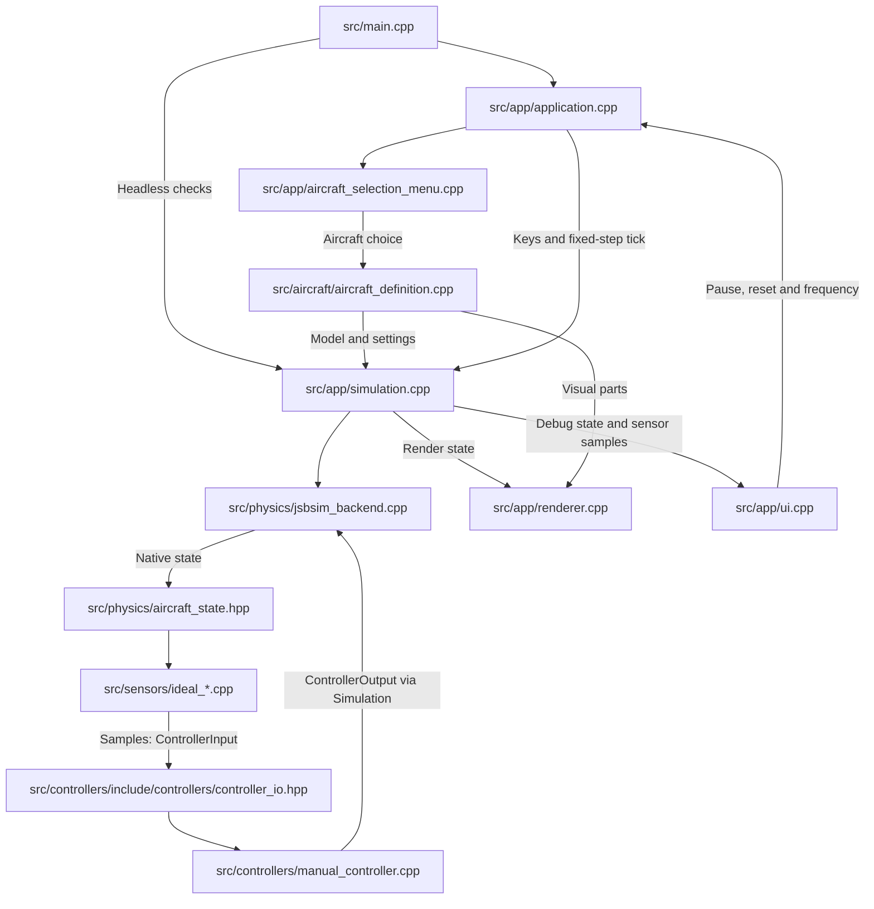

# Daedalia Physics Sim

## Current state

JSBSim 1.3.2 has replaced Jolt, including ground reactions. F450 quadcopter and C172 are selectable at startup or with `--aircraft f450|c172`. Both currently offer ManualController.

OpenGL draws representative aircraft parts, with pose, propellers and hinged surfaces driven by JSBSim. ImGui shows physics and programmable sensor readings. Backend smoke checks and offscreen rendering checks passed; this is not full model/controller validation.

## Structure and flow

- `src/aircraft/`: one AircraftDefinition owns each aircraft's model, initial conditions, integration settings, graphics references, control bindings and available controllers. Drones and planes use the same system.
- `src/physics/`: JSBSim backend and native aircraft state.
- `src/sensors/`: programmable ideal IMU, local GPS, barometer and magnetometer.
- `src/controllers/`: one ControllerInput / ControllerOutput contract and ManualController. Original controller algorithms remain untouched and excluded from the build.
- `src/app/`: startup selection, fixed-step loop, SDL window, camera, ImGui and OpenGL. `src/main.cpp` launches interactive or headless mode.

The old `src/drones/` files were removed; any remaining folders are empty leftovers. Custom drone declarations are recoverable through Git history, not ported JSBSim aircraft.

Main file flow (arrows show calls or data passed between files):



## Boundaries

Physics and sensors keep native units: feet, ft/s, ft/s², psf, slugs and radians. Controllers own any conversions. Body axes are forward/right/down; GPS uses local NED. Ground truth is not part of ControllerInput.

Rendering also uses feet, mapping axes to X right, Y up, -Z forward. Ground reactions are JSBSim only; visual meshes do not provide arbitrary collisions.

The configurable controller/sensor tick defaults to 60 Hz. Each aircraft owns a smaller maximum internal physics interval where needed; commands are held across substeps. Reset restores starting physics, sensors and manual controller state.

Manual is a normal controller. F450 currently uses its bundled stabilization/mixer; C172 uses standard surface commands. Indexed motor commands exist in the unified output but are not connected to JSBSim yet.

## Build and run

```sh
cmake -S . -B build
cmake --build build -j4
./build/daedalia
ctest --test-dir build --output-on-failure
```

CMake downloads dependencies and copies JSBSim model data to `build/jsbsim-data`; its configured path works independently of the launch directory. See README for keyboard controls and direct aircraft/headless launch flags.

## Next step: approval required

Migration stages 1–5 are complete. Do not adapt existing controllers until the user explicitly approves. Review controllers individually, then custom aircraft declarations.

The next proposed choice is F450 direct-motor control versus using its bundled stabilization/mixer. Direct motors would let existing controllers own stabilization and mixing, but motor order, directions and bindings must first be checked. This choice is not approved yet.

## Limitations and deferred ideas

Stock F450 data emits configuration-version and internal sensor-binding warnings. Stepping and lift-off worked; model validation/tuning remains separate work.

Deferred: sensor noise/sample rates, telemetry CSV, movement trails, richer aircraft assets and map geometry. Preserve the custom-aircraft ideas: check triangular-bipyramid torque directions, add its altitude/GPS position hold, and explore a 4-by-4-rotor zero-gravity aircraft.

## Later work

- Individual controller and custom aircraft migrations.
- Sensor noise and independent sample rates.
- Telemetry CSV and movement trails.
- More detailed aircraft assets only if wanted.
- Map geometry (visual only until terrain/ground support is deliberately extended).
- Preserved custom-aircraft ideas: verify triangular-bipyramid torque directions, add its altitude and GPS position hold, and explore a 4-by-4-rotor zero-gravity aircraft. These are deferred, not automatically supported by the bundled models.
