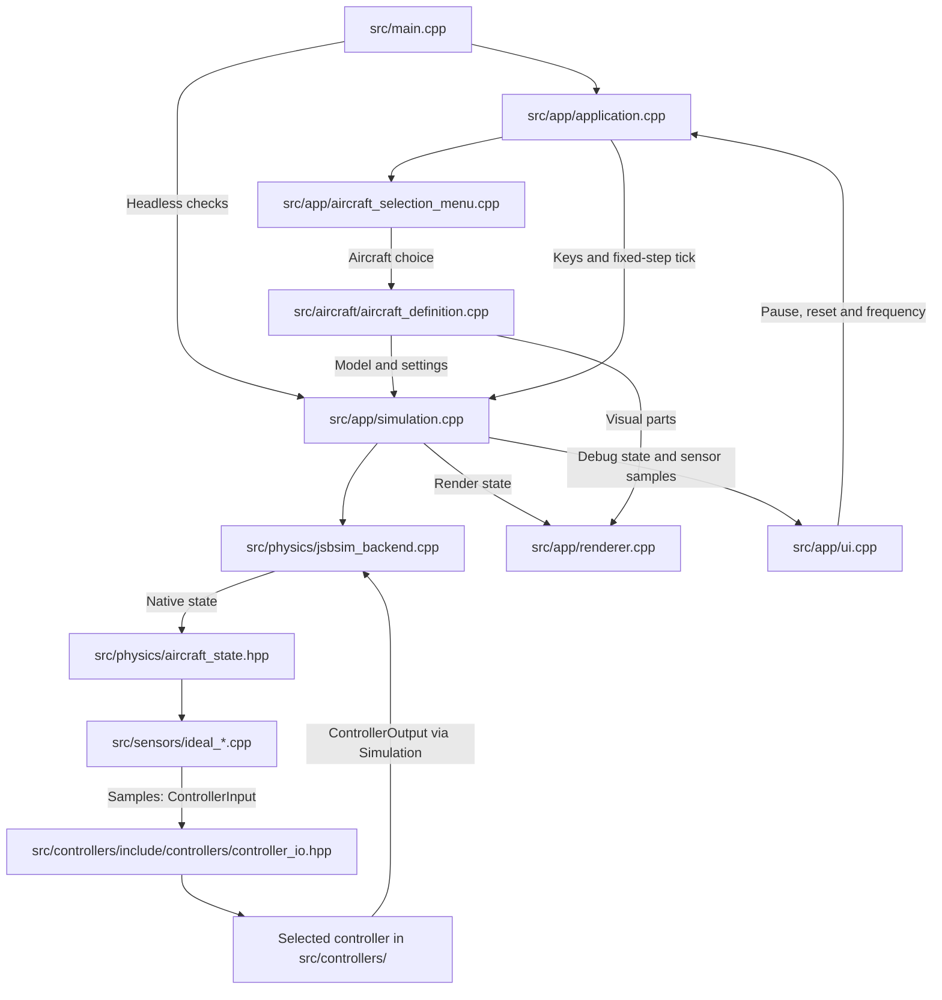

# Daedalia Physics Sim

## Current state

JSBSim 1.3.2 has replaced Jolt, including ground reactions. F450 quadcopter and C172 are selectable at startup or with `--aircraft f450|c172`.

- F450 exposes demo, angle, horizon, and position hold. Demo writes four normalized motor commands directly. The other modes own their motor mixing. The position-hold implementation currently handles altitude and leveling, with horizontal position control still pending.
- C172 uses a direct controller for throttle, aileron, elevator, rudder, flaps, and brakes.

OpenGL draws representative aircraft parts, with pose, propellers and hinged surfaces driven by JSBSim. ImGui shows physics and programmable sensor readings. Backend smoke checks and offscreen rendering checks passed; this is not full model/controller validation.

## Structure and flow

- `src/aircraft/`: one AircraftDefinition owns each aircraft's model, initial conditions, integration settings, graphics references, control bindings and available controllers. Drones and planes use the same system.
- `src/physics/`: JSBSim backend and native aircraft state.
- `src/sensors/`: programmable ideal IMU, local GPS, barometer and magnetometer.
- `src/controllers/` defines the shared `ControllerInput` / `ControllerOutput` contract and implements the selectable F450 and C172 controllers.
- `src/app/`: startup selection, fixed-step loop, SDL window, camera, ImGui and OpenGL. `src/main.cpp` launches interactive or headless mode.

The old `src/drones/` files were removed; any remaining folders are empty leftovers. Custom drone declarations are recoverable through Git history, not ported JSBSim aircraft.

Main file flow (arrows show calls or data passed between files):



## Boundaries

Physics and sensors keep native units: feet, ft/s, ft/s², psf, slugs and radians. Controllers own any conversions. Body axes are forward/right/down; GPS uses local NED. Ground truth is not part of ControllerInput.

Rendering also uses feet, mapping axes to X right, Y up, -Z forward. Ground reactions are JSBSim only; visual meshes do not provide arbitrary collisions.

The configurable controller/sensor tick defaults to 60 Hz. Each aircraft sets its maximum internal physics interval. Commands are held across substeps. Simulation reset restores physics, refreshes sensors, and calls each controller's reset hook.

Each aircraft declares the controllers it can run. The F450 demo writes its four indexed motor commands through the unified output; the C172 direct controller writes named fixed-wing actuator commands. JSBSim's stock F450 SCAS and C172 autopilots are disabled.

## Build and run

```sh
cmake -S . -B build
cmake --build build -j4
./build/daedalia
ctest --test-dir build --output-on-failure
```

CMake downloads dependencies and copies JSBSim model data to `build/jsbsim-data`; its configured path works independently of the launch directory. See README for keyboard controls and direct aircraft/headless launch flags.

## Neural Network experiment

- Start with a headless runner over `Simulation` for scripted hover and climb/descent steps at 60 Hz. Compare tracking error, overshoot, settling time, and motor saturation.

- - 2 controllers
- One uses NN to adjust the hover throttle, i guess to adjust to different weights and external conditions
- The other directly uses the NN to controll altitude correction, so it would replace the PID

We could vary, weight, wind, and position? where would a pid perform poorly? outside its tuning hypothesis.

We would need to make a position hold alcually hold position tho

- Train a small model with CPU PyTorch using measured hover commands across simulated configurations, starting with mass variation. Evaluate closed-loop flights on held-out configurations. Use a Gymnasium `reset()` / `step(action)` wrapper over the same simulator if reinforcement learning becomes useful.


## Limitations and deferred ideas

Stock F450 data emits configuration-version and internal sensor-binding warnings. The smoke checks cover basic simulator behavior. Flight stability and controller tuning need dedicated checks.

- Individual controller and custom aircraft migrations.
- Sensor noise and independent sample rates.
- Telemetry CSV and movement trails.
- More detailed aircraft assets only if wanted.
- Map geometry (visual only until terrain/ground support is deliberately extended).
- Preserved custom-aircraft ideas: verify triangular-bipyramid torque directions, add its altitude and GPS position hold, and explore a 4-by-4-rotor zero-gravity aircraft. These are deferred, not automatically supported by the bundled models.
